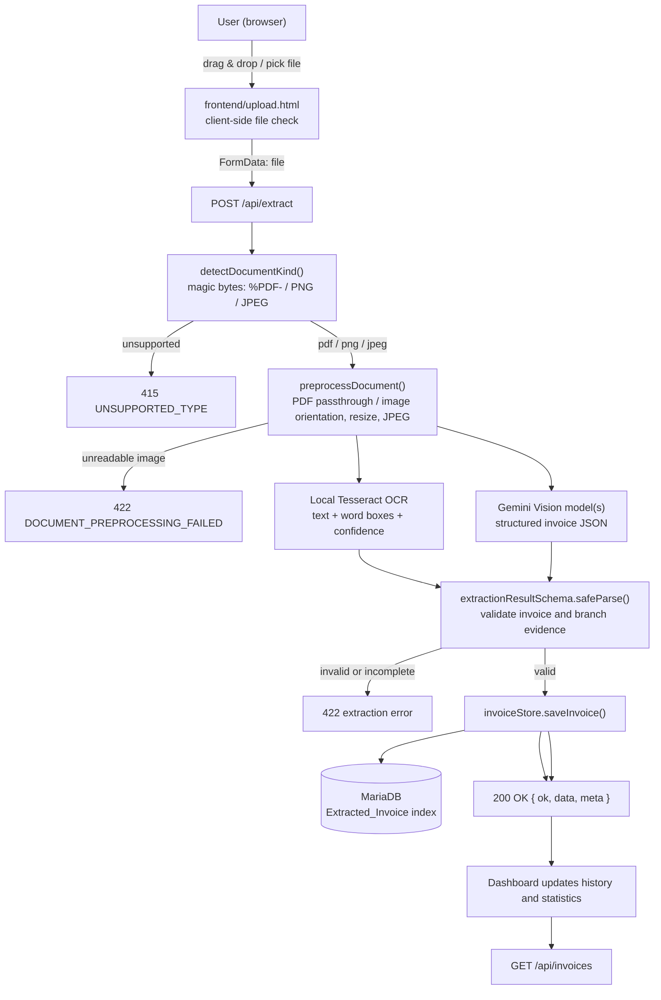

# Architecture

> Describes the **actual implementation** as of 26/10/2026.
> Everything not yet implemented is explicitly labelled **Planned / not implemented**.
> Related: `projectOverview.md` (what/why) · `apiDocs.md` (API contract) · `configuration.md` (environment)

---

## 1. Repository Structure

```text
ATI_PhAnh_group/
 .devcontainer/                 # DevContainer (Node 20.18.0 bookworm, port 3000)
 app/                           # Next.js App Router (real application)
   ├── api/
   │   ├── extract/route.ts       # POST  /api/extract   (upload → Gemini JSON → store)
   │   └── invoices/route.ts      # GET   /api/invoices  (list) + DELETE (reset)
   ├── globals.css                # Plain CSS (no Tailwind)
   ├── layout.tsx                 # Root layout / metadata
   ├── page.tsx                   # Displays the dashboard from /upload.html at /
   ├── upload.html/route.ts       # Serves frontend/upload.html at /upload.html
   ├── upload.css/route.ts        # Serves frontend/upload.css at /upload.css
   ├── upload.js/route.ts         # Serves frontend/upload.js at /upload.js
   ├── detail.html/route.ts       # Serves frontend/detail.html at /detail.html
   ├── detail.css/route.ts        # Serves frontend/detail.css at /detail.css
   └── detail.js/route.ts         # Serves frontend/detail.js at /detail.js
 frontend/                       # Single source for the static dashboard and detail UI
   ├── upload.html
   ├── upload.css
   ├── upload.js
   ├── detail.html
   ├── detail.css
   └── detail.js
 components/
   ├── UploadBox.tsx              # Submission box: drag&drop + file picker + status pill
   ├── InvoiceResult.tsx          # Invoice card, line items, totals, raw JSON, download
   └── InvoiceHistory.tsx         # List of stored invoices + refresh/reset
 lib/
   ├── invoiceSchema.ts           # Zod contract (single source of truth for the JSON shape)
   ├── documentPreprocessing.ts    # Server-side image orientation, resize and JPEG normalization
   ├── documentOcr.ts             # Local Tesseract OCR; renders PDF pages for OCR
   ├── geminiExtractor.ts         # Gemini multimodal extraction (server only)
   ├── mockExtractor.ts           # Document-kind detection and legacy mock helpers
   ├── database.ts                # MariaDB pool and MongoDB connection
   ├── invoiceStore.ts            # MariaDB index + MongoDB extraction payloads and originals
   ├── uploadConfig.ts            # Shared upload rules (client-safe, no Node imports)
   └── format.ts                  # VND / bytes / date / percent formatting
 scripts/make-sample-pdf.mjs    # Generates samples/sample-invoice.pdf (test fixture)
 samples/sample-invoice.pdf     # 2-page sample invoice for manual testing
 data/                          # Legacy local data directory (not used by invoice storage)
 knowledge/                     # Project knowledge (this documentation system)
 requestFromUsers/              # Original human requests
 state/                         # Task state / handoff
 features.md · todolist.md · architecture_explanation.md
 package.json · tsconfig.json · next.config.ts · eslint.config.mjs · .gitignore
```

---

## 2. Technology Stack (as implemented)

| Layer | Technology | Notes |
| --- | --- | --- |
| Framework | Next.js `15.5.26`, App Router | Installed via `npm install` (308 packages, `package-lock.json` committed on 30/09/2026) |
| UI library | React `19.1.0` | Next.js page hosts the full-screen dashboard from `frontend/` |
| Language | TypeScript `^5`, `strict: true` | `npm run typecheck` (`tsc --noEmit`) |
| Validation | Zod `^4.6.5` | `lib/invoiceSchema.ts` — validates the extraction result before storage |
| Image preprocessing | Sharp `^0.35.5` | Server-side EXIF orientation, resize without upscaling, white alpha flattening, JPEG quality 92 |
| OCR | Tesseract.js `^6.0.1` | Local Vietnamese + English text, word boxes and confidence |
| PDF rendering | PDF.js `^4.10.38` + `@napi-rs/canvas` | Rasterizes PDF pages locally for OCR |
| OCR | Tesseract.js `^6.0.1` | Local Vietnamese + English OCR with word boxes and confidence; PDF pages are rendered with PDF.js and native canvas |
| PDF rendering | PDF.js `^4.10.38` + `@napi-rs/canvas` | Render PDF pages for the local OCR branch; original PDF remains the Vision input |
| Styling | Plain CSS (`app/globals.css`) | No Tailwind/PostCSS configured on purpose |
| Lint | ESLint 9 + `eslint-config-next` 15.5.26 | Flat config `eslint.config.mjs`; see known risk in §8 |
| Storage | MariaDB `Extracted_Invoice` + MongoDB `Extraction_Records` | SQL metadata index and full extraction JSON payload |
| Runtime | Node.js `20.18.0` (devcontainer) | Port 3000 |
| External services | Google Gemini API | Vision branch sends PDFs unchanged and preprocessed images; requires server-side API key |

---

## 3. Components and Responsibilities

| Component | File | Responsibility |
| --- | --- | --- |
| Home page | `app/page.tsx` | Displays the full-screen dashboard |
| Dashboard | `frontend/upload.html` + `frontend/upload.css` + `frontend/upload.js` | Upload UI, statistics and history; calls same-origin API routes |
| Invoice detail | `frontend/detail.html` + `frontend/detail.css` + `frontend/detail.js` | Fetches selected record and original PDF/image using its `recordId` |
| Legacy React components | `components/` | Alternative upload, result and history components; dashboard at `/` uses the static frontend |
| Upload rules | `lib/uploadConfig.ts` | Accepted types/extensions, 10 MB limit, `validateUploadFile()` used by the browser |
| Schema | `lib/invoiceSchema.ts` | Zod schemas + TypeScript types for `ExtractionResult` |
| Document preprocessing | `lib/documentPreprocessing.ts` | PDFs pass through unchanged; PNG/JPEG images are auto-oriented, resized to fit 2400×3200 without upscaling, flattened onto white and encoded as JPEG quality 92 |
| OCR extraction | `lib/documentOcr.ts` | Runs local Vietnamese/English OCR on prepared images or rendered PDF pages; returns page text, word bounding boxes and confidence |
| Dual-branch extraction | `lib/geminiExtractor.ts` | Runs local OCR and one or more configured Gemini Vision models concurrently; stores OCR evidence and all model outputs |
| Document metadata | `lib/mockExtractor.ts` | Magic-byte kind detection and PDF page estimate |
| Database connections | `lib/database.ts` | Shared MariaDB pool and MongoDB connection from server-side environment variables |
| Invoice store | `lib/invoiceStore.ts` | `listInvoices` / `saveInvoice` / `getInvoiceDocument` / `clearInvoices` across MariaDB and MongoDB |
| API: extract | `app/api/extract/route.ts` | Validates the upload, runs the extractor, validates with Zod, stores, returns JSON |
| API: invoices | `app/api/invoices/route.ts` | Lists stored invoices / resets invoice records in both databases |
| API: original document | `app/api/invoices/[recordId]/document/route.ts` | Returns a saved original PDF/image for the detail-page preview |

---

## 4. End-to-End Data Flow (implemented)



### Sequence (upload → JSON → database)

```mermaid
sequenceDiagram
    participant U as User
    participant P as page.tsx
    participant R as /api/extract
    participant S as Sharp preprocessing
    participant O as Local Tesseract OCR
    participant X as Gemini API
    participant Z as Zod schema
    participant M as MariaDB
    participant D as MongoDB

    U->>P: chọn file (PDF/PNG/JPEG)
    P->>P: validateUploadFile() (type, size)
    P->>R: POST multipart/form-data (file)
    R->>R: size + magic-byte validation
    R->>S: preprocess after confirming Gemini is configured
    Note over S: PDF is unchanged; PNG/JPEG auto-oriented, resized without enlargement, flattened white and encoded as JPEG
    S-->>R: prepared document + MIME type
    par OCR branch
        R->>O: prepared image / rendered PDF pages
        O-->>R: text, word bounding boxes and confidence
    and Vision branch(es)
        R->>X: prepared document + configured model(s)
        X-->>R: structured invoice JSON per model
    end
    R->>Z: validate invoice + OCR and Vision branch results
    Z-->>R: valid
    R->>M: save invoice metadata
    R->>D: save full extraction payload
    R-->>P: 200 { ok: true, data }
    P->>U: invoice card + raw JSON
```

---

## 5. API Surface (summary)

| Method | Path | Purpose |
| --- | --- | --- |
| `POST` | `/api/extract` | Upload a PDF/PNG/JPEG, return + store the extraction result |
| `GET` | `/api/invoices` | List stored invoices |
| `DELETE` | `/api/invoices` | Delete stored invoice records from MariaDB and MongoDB (demo helper) |

Details, payloads and error codes: `knowledge/apiDocs.md`.

---

## 6. External APIs

The extraction API calls Google's Gemini API. `GEMINI_API_KEY` is required for uploads;
the key stays on the server in the ignored `.env.local` file.

Uploaded PDF files are transmitted unchanged to Google; uploaded PNG/JPEG images are transmitted after
the documented preprocessing above. Check organizational privacy
requirements and Google's current pricing and quota before uploading sensitive documents.
OCR runs locally; the Tesseract language model may be downloaded on first use.
OCR itself runs locally; Tesseract may download its configured language data on first use.

---

## 7. External Services / Credentials

* A Gemini API key is required to extract invoice data; the dashboard and history can load without it.
* `.env*` is gitignored. Do not commit secrets (see `agents.md`).

---

## 8. Important Constraints and Known Limitations

1. **Gemini extraction requires an API key and network access.** Incomplete results are rejected instead of being saved as guessed invoice data.
2. **Image preprocessing is intentionally non-destructive:** images are auto-oriented, resized only when larger than 2400×3200, flattened on white, and JPEG-encoded at quality 92. No contrast enhancement is applied. Original bytes determine stored source metadata and content hash.
3. **OCR is local and resource-bounded:** PDF OCR renders up to 50 pages; OCR language defaults to `vie+eng`. One or more Vision model names can be selected with `GEMINI_MODELS`; each configured Vision result is returned separately. The first result remains the legacy top-level invoice; no automatic reconciliation is claimed.
4. **Validation status (30/09/2026)** — `npm install`, `npm run typecheck`, `npm run lint` and 7 `curl` API cases all passed; two bugs were found and fixed during validation. A full `npm run build` and the browser click-through are still pending. Evidence: `state/task_30_09_state.md` §5.
5. **ESLint engine risk** — `eslint-visitor-keys@5` requires Node `^20.19.0 || ^22.13.0 || >=24`, but the image pins `node:20.18.0` (`npm warn EBADENGINE`). `npm run lint` may fail until the image is bumped (e.g. `node:20.19.0-bookworm`) or ESLint is removed.
6. **Polyglot persistence** — MariaDB stores indexed invoice metadata and MongoDB stores each complete extraction payload; the API lists the latest 50 records.
7. **No authentication / RBAC**; every request can read and reset invoice storage.
8. **Upload limit** 10 MB; accepted: `application/pdf`, `image/png`, `image/jpeg` (client checks mime type or extension, server checks magic bytes).
9. **Client-safe constants** must stay in `lib/uploadConfig.ts`; `lib/mockExtractor.ts` and `lib/invoiceStore.ts` import `node:crypto` / `node:fs` and must never be imported by client components.

---

## 9. Design Decisions

| Decision | Reason |
| --- | --- |
| Gemini extractor behind the real Zod contract | Provider output is validated, and incomplete results are rejected rather than being saved as real invoice data |
| Zod as the single response contract | Matches the project's "Structured Output Validation" goal (`project_details.md`) |
| MariaDB index + MongoDB payload | Reuses the team's running database services and keeps the full extraction evidence flexible |
| Plain CSS, no Tailwind | Avoids extra build configuration for a prototype |
| Upload rules duplicated client + server | Client gives instant feedback; the server stays authoritative |

---

## 10. Demo Flow

```text
npm install
create .env.local with GEMINI_API_KEY
npm run dev
open http://localhost:3000
select a readable PDF / JPG / PNG
Gemini extracts invoice fields and saves the record
dashboard statistics and history display the result
```

Manual test steps with expected results: `features.md`.

---

## 11. Planned / Not Implemented

* Authentication + department-scoped RBAC.
* Authentication + department-scoped RBAC.
* Batch jobs / model selection per job.
* Automated tests (no test runner is configured yet).
